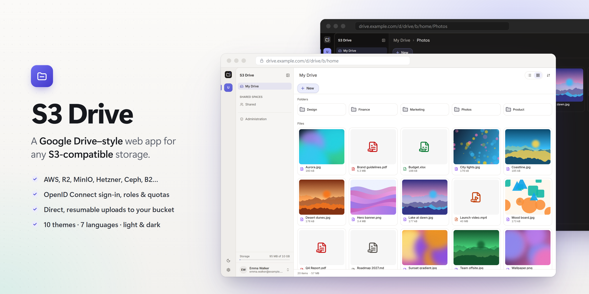

<p align="center"></p>

# S3 Drive

A Google Drive–style web app for **any S3-compatible storage** (AWS, Cloudflare R2, Hetzner, MinIO, Ceph, B2…).
Files go straight between the browser and S3 through presigned URLs; the server only keeps metadata in SQLite.

Two modes:

- **Personal** — anyone connects their own S3 credentials from the browser.
- **Instance** — the operator declares storages, spaces and roles in a YAML file; people sign in with any
  OpenID Connect provider (e.g. Keycloak). Each person gets a private drive with a quota, shared spaces
  follow their roles, and a super admin sees everything.

Grid and list explorer, drag and drop, resumable multipart uploads, previews, a link for every file and
folder, 10 themes, 7 languages (RTL included), light and dark.

## Quick start

Requires Node 24 and Docker.

```sh
npm install
docker compose -f compose.dev.yaml --profile iam up -d   # local S3 (RustFS) and Keycloak
node dev/s3-bucket.mjs                                   # dev bucket and its CORS rule
node dev/start-instance.mjs                              # server :18080, web :5290
```

Open http://localhost:5290 and sign in with a test account from `dev/keycloak/ud-dev-realm.json`.

```sh
npm test                               # unit and integration tests
node dev/e2e/instance-keycloak.mjs     # end-to-end run against the local Keycloak
```

## Layout

`apps/web` (React, TanStack Router) · `apps/server` (Hono, Node 24) · reusable packages:
`@ud/contracts` (schemas), `@ud/s3` (S3 engine), `@ud/sdk` (typed client, resumable uploads), `@ud/ui`
(components and themes). Production image: `Dockerfile` (port 8080, data in `/data`).
